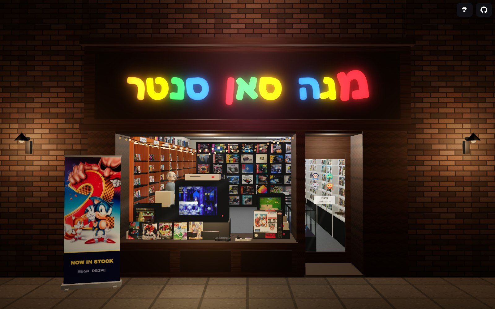
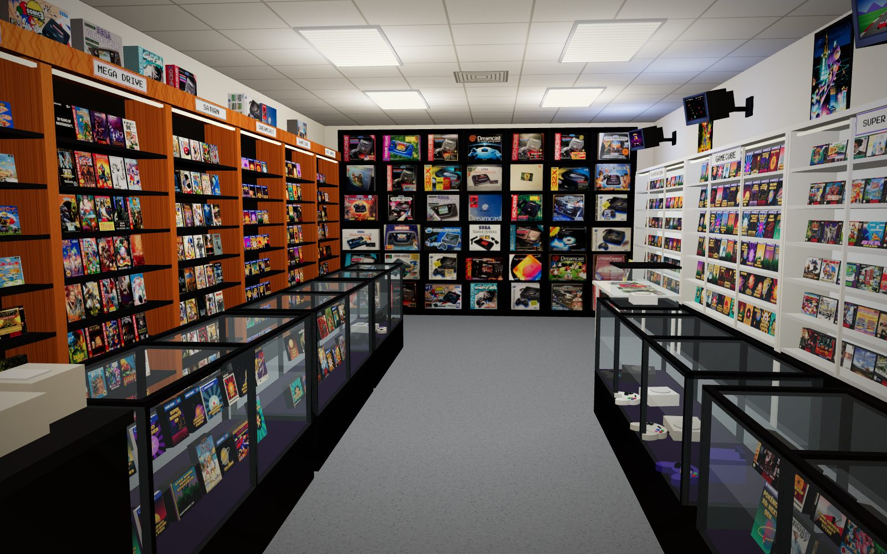
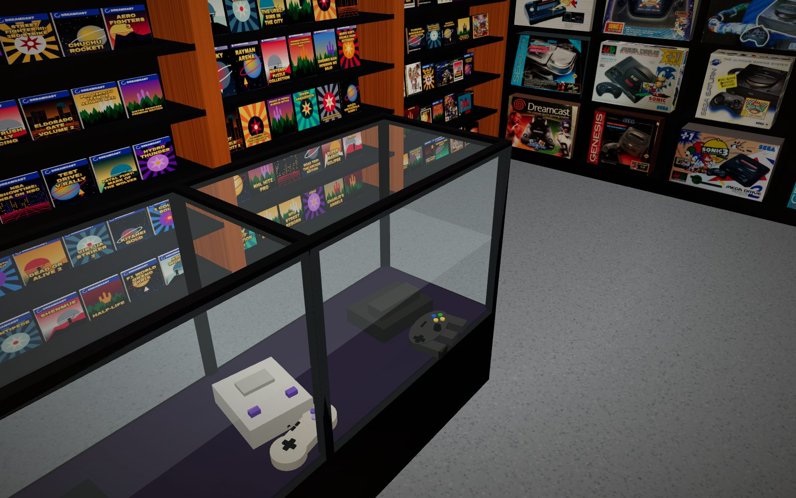
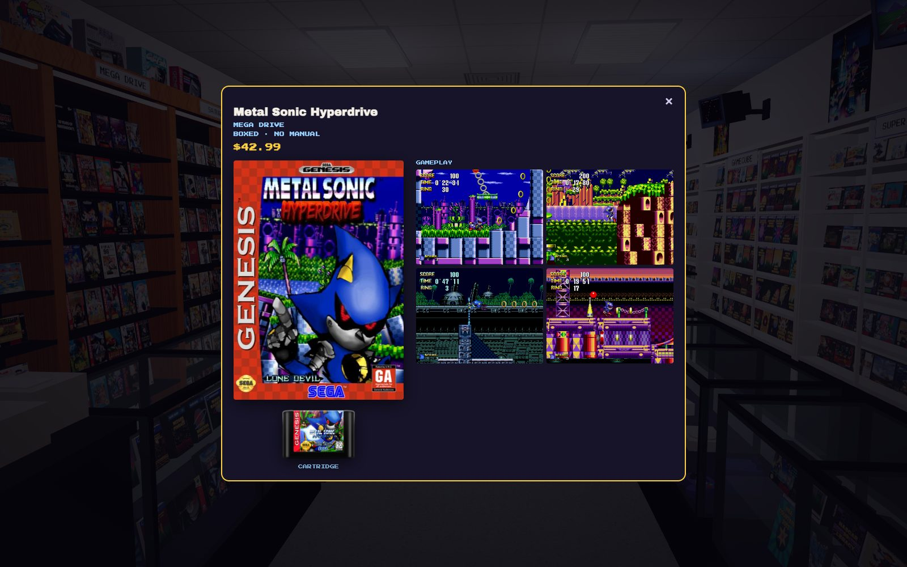
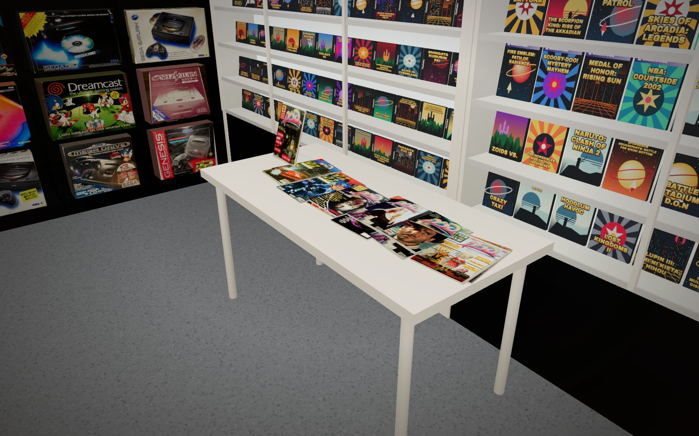
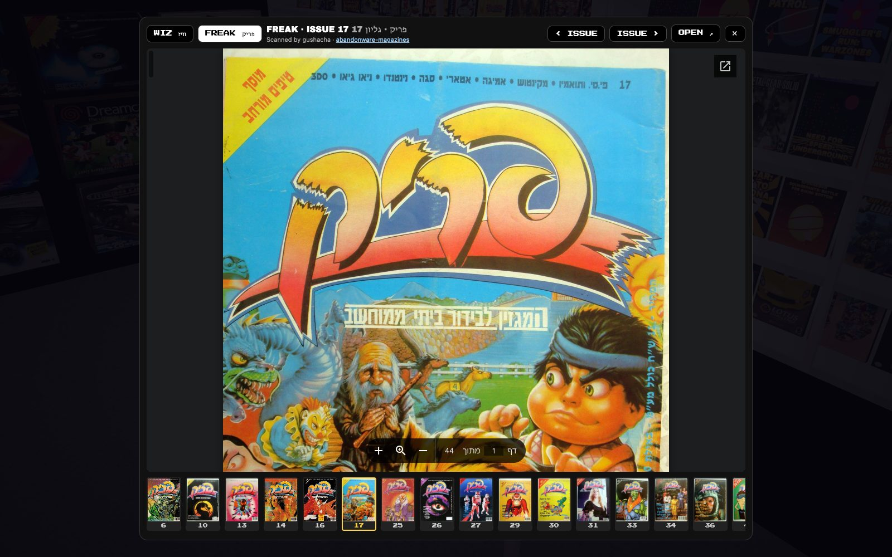

# Megason Center

באמצע שנות ה-90 נחשפתי לעולם המרהיב של תעשיית הגיימינג, הכל היה רענן והיו קפיצות דוריות בין טכנולוגיות ובמרכז של כל זה היתה חנות קטנה בשם מגה סאן סנטר שהתחילה את דרכה כחנות קטנה בקניון של נווה חוף ואחרי כמה שנים עברה החנות לקניון הזהב.

המוכר היה משה (שלימים כונה כ׳פטיש׳ כי היה קשוח בתמחורים), אבל היה לי חיבור טוב איתו ובכל הזדמנות שהיתה לי הייתי בא לבקר גם אם לא באתי לקנות או להחליף משחק. פשוט להיות שם ולהתפעם מכמות מטורפת של משחקים שבחיים לא אוכל לשחק בכולם.

זה היה הנטפליקס של פעם,  היה שם הכל - קונסולות, מגזינים, מכוניות שלט משוכללות והחנות שרדה זמן מרשים עד לסגירתה ב-2013 זאת היתה ה-חנות שריכזה את כל מה שאהבתי במקום אחד, הפרויקט הזה בא לחלוק כבוד לאיש והאגדה שרבים אחרים התחקו אחריו ברחבי הארץ. ❤️

---

In the mid-90s, I was introduced to the fascinating world of the gaming industry. Everything felt fresh and exciting, with major generational leaps in technology happening one after another. At the heart of it all was a small store called Megason Center.

It started out as a tiny shop in Neve Hof Mall and, a few years later, moved to to a big mall. The guy behind the counter was Moshe, who would later earn the nickname “The Hammer” for being notoriously tough when it came to pricing.

Despite that, we had a great connection. Whenever I had the chance, I would stop by, even if I wasn't there to buy or trade a game. I just wanted to hang around and take in the mind-blowing collection of games, knowing full well I'd never get to play them all.

It was the Netflix of its time. They had everything: consoles, gaming magazines, sophisticated RC cars, and so much more. The store had an impressive run before finally closing its doors in 2013.

It was the place that brought everything I loved under one roof. This project is a tribute to the man and the legend, whose legacy inspired many others to follow in his footsteps across the country. ❤️

https://web.archive.org/web/20020119225225/http://www.megasoncenter.co.il/

---

| | |
|---|---|
|  |  |
| Walk the aisles: shelves per system, glass counters, wall CRTs | Consoles with matching controllers in the glass cases |
|  |  |
| Click any game for its box art, disc/cartridge and gameplay shots | The magazine table with real Wiz and Freak issues |

## Updating the data

- `python3 launchbox_covers.py --metadata Metadata.zip` – picks cover art links per system (download `Metadata.zip` from LaunchBox first; it isn't stored in this repo).
- `python3 launchbox_media.py` – adds gameplay screenshots and disc/cartridge images for each title.
- `python3 magazine_links.py` – refreshes the Wiz and Freak issue links from the [abandonware magazine archive](https://github.com/abandonware-magazines/abandonware-magazines.github.io).

All three only store links in `megason.html`; no images are downloaded.
